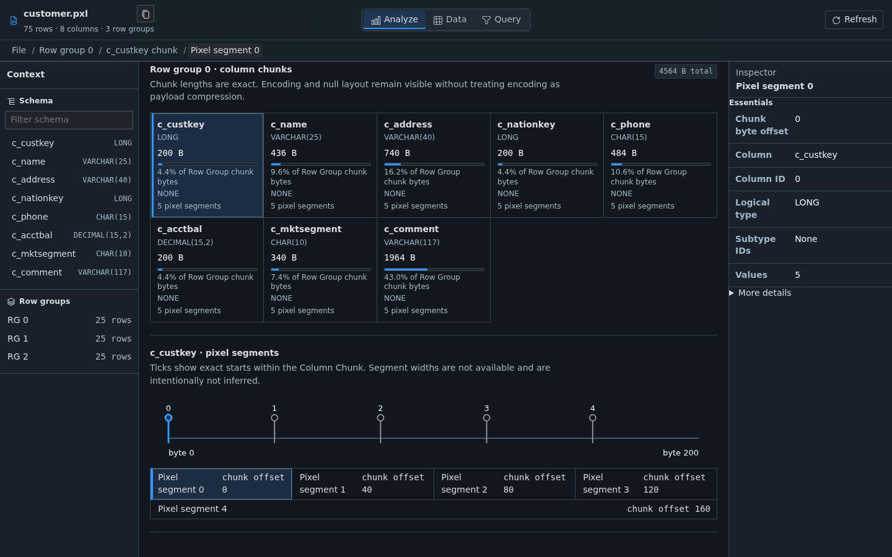
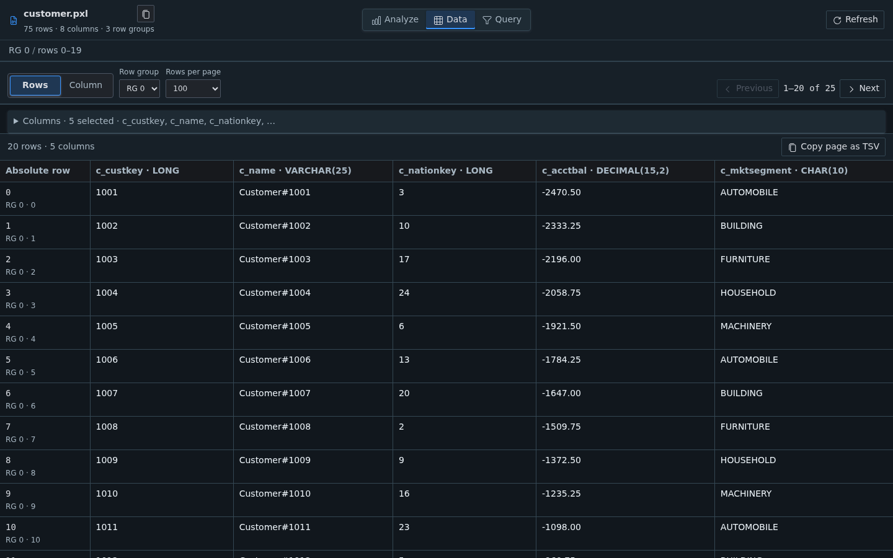
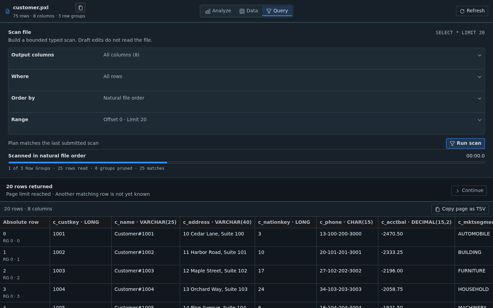

<p align="center">
  
</p>

# Pixels Inspector for VS Code

Pixels Inspector is a read-only, cross-platform VS Code extension for exploring Pixels (`.pxl`) files without requiring a JVM or service runtime.

## Getting started

Open a `.pxl` file in VS Code to launch the Pixels Inspector custom editor. The workspace follows the active light, dark, or high-contrast theme and keeps logical data, schema facts, statistics, and physical layout linked as you move through the file.

## Features

Analyze physical storage, browse exact values, and run bounded local queries from one focused editor. The portable WebAssembly Core keeps parsing on your machine and works without a JVM, database, or service.



*Analyze follows File → Row Group → Column Chunk → Pixel with linked schema and physical layout.*



*Data provides bounded row and column browsing with exact value rendering.*



*Query builds and runs bounded scans with typed predicates, ordering, progress, and continuation.*

## Example file

[`examples/customer.pxl`](examples/customer.pxl) contains 75 deterministic TPC-H customer-shaped rows across three Row Groups. Each of its eight columns contains five Pixel segments per Row Group, making the storage hierarchy easy to explore. Download or clone the repository, then open the file in VS Code.

## Settings

Configure Pixels Inspector in VS Code settings. All settings are resource-scoped, so they can vary by workspace or file context.

| Setting | Default | Options |
|---|---:|---|
| `pixels.inspector.defaultPageSize` | `100` | `25`, `50`, `100`, `200`, or `500` rows |
| `pixels.inspector.defaultDataOrientation` | `rows` | `rows` or `column` |
| `pixels.inspector.timestampDisplay` | `utc` | `utc`, `raw`, or `local`; clipboard output preserves exact stored microseconds |
| `pixels.inspector.maxVirtualFileSizeMiB` | `64` | `1`–`256` MiB; applies to immutable virtual-resource snapshots |

## Platform and format support

Pixels Inspector supports desktop, Remote, virtual-workspace, and browser extension hosts. The same WebAssembly Core is packaged for Linux, macOS, and Windows on x64 and arm64.

Local and Remote `file:` resources use bounded positional reads. Browser and virtual-workspace resources use a stat-checked immutable snapshot, with a configurable 64 MiB default limit and a 256 MiB safety ceiling. Direct S3, HDFS, HTTP, and other object-store protocols are not currently supported.

The V1 conformance inventory covers all eight TPC-H tables and 61 columns, with the 16-column `lineitem` shape as the representative integration schema. It exercises the declared RLE/dictionary encoding matrix, DECIMAL precisions through 38 digits, TIMESTAMP precisions 0–6, byte-order variants, and writer-timezone provenance.

Pixels V1 records compression enum metadata but does not compress payload bytes. The inspector displays every declared compression enum value as inactive metadata and does not claim codec support that the format does not use.

## Privacy and security

Pixels Inspector is read-only. It does not modify PXL files, collect telemetry, or send file contents to a service. Parsing runs locally in a verified WebAssembly worker, and local or Remote files are read through bounded ranges.

Report defects and security concerns through the [GitHub issue tracker](https://github.com/AntiO2/pixels-vscode-extension/issues). The source is available under the GNU Affero General Public License v3.0 or later.

## Development

Development requires Node.js 24 or newer. CMake, Ninja, and the pinned Emscripten toolchain are also required when rebuilding the portable Core.

```sh
npm ci
npm run check
npm run package:vsix
```

Core changes must be built from the `third_party/pixels` submodule through the repository scripts. See [`docs/core-bump.md`](docs/core-bump.md) for the reviewed update process.
